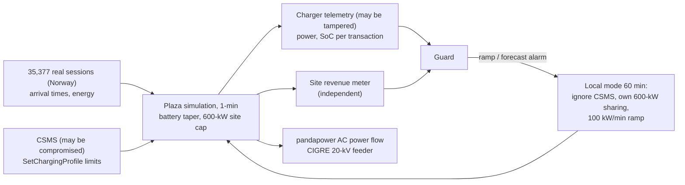
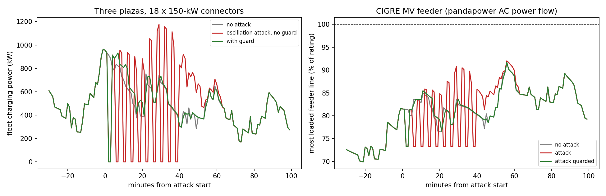

# evcs-grid-surge-guard

**Can hackers use EV fast chargers to stress the power grid, and can the charging site stop them?** Three
DC fast-charging plazas (18 × 150-kW connectors) on the CIGRE 20-kV benchmark feeder. A compromised charging
management system (CSMS) or tampered chargers attack them, and a site-level guard detects and contains the
attacks. Power flow comes from pandapower; the guard combines physics checks, an independent meter
cross-check and an LSTM load forecaster.

**Headline (8 attack days, 7 benign days, attacks launched when the most cars were plugged in):**

* **Load oscillation is the dangerous attack.** Toggling every charger between 0 and 150 kW swung fleet load
  by up to 1,177 kW in one minute (benign maximum 382). The guard caught it within 4 minutes, and local mode
  returned peak load and line loading to their no-attack values.
* **Raising every charger to full power did nothing measurable.** Plugged-in cars can only accept what their
  batteries allow, and with 8-12 of 18 connectors in use the site caps never bound. The attack surface is
  sized by occupancy and battery physics, not by charger nameplate.
* **Lies in the telemetry are caught in 0-3 minutes:** spoofed state of charge by a physics check, under-
  reported power by comparing against the site's revenue meter.
* **Zero false alarms in 7 benign test days** (after one honest fix, Section 4).

---

## 1. Problem formulation

Fast chargers are large, fast, remotely controllable loads: one plaza can swing nearly a megawatt within a
minute, and they are managed over the internet through OCPP. Load-altering attacks on many chargers at once
could overload feeders or cause voltage problems. The charging operator's view also depends on what chargers
report, which can be falsified. The question: what can an attacker actually do to the feeder, and what can a
site controller detect and stop by itself?

| Bar | Here |
|---|---|
| **Power / transportation** | Real EV demand patterns, CC-CV battery acceptance, site power caps, AC power flow on the CIGRE MV benchmark (line loading, voltage), evening-peak timing |
| **ML / detection** | LSTM next-minute load forecaster, thresholds from 21 benign days only, physics plausibility checks, independent-meter reconciliation |
| **Systems / security** | Attack model split by layer (control vs telemetry), local fail-safe mode that overrides the CSMS, FastAPI telemetry-check service, Docker |

---

## 2. Architecture



---

## 3. Methodology

**Demand.** Arrival times of day and energy needs are sampled from 35,377 real charging sessions (12 residential
sites in Norway, 2018-2021; Zenodo record 13896176), energy doubled and clipped to 8-60 kWh to resemble fast-
charging sessions. These are home-charging patterns transplanted onto fast chargers, a stated assumption.
About 220 sessions per day across the three plazas.

**Battery and control.** Packs of 50-100 kWh and peak charge power of 100-200 kW. Full power up to 55% state of
charge, tapering linearly to 15% of peak at 100%. Drivers leave at 80% or after 45 minutes. The CSMS shares each
plaza's 600-kW cap in proportion to what each car can accept. Physical power is
$\min(\text{limit}, 150\text{ kW}, \text{acceptance}(SoC))$.

**Grid.** CIGRE 20-kV MV benchmark (pandapower), base loads scaled by a daily profile (45% at night, 82% in the
evening peak), plazas at buses 5, 10 and 14 near the feeder ends, AC power flow every minute around each attack.

**Attacks** (one per test day, launched at the 16:30-19:30 minute with the most cars connected):

| Attack | Layer | What happens |
|---|---|---|
| sync_ramp | control | every connector at every plaza set to 150 kW for 30 min, site caps ignored |
| oscillation | control | all limits toggled between 0 and 150 kW every 2 min for 40 min |
| soc_spoof | telemetry | chargers at one plaza report a frozen 20% SoC for 60 min |
| meter_tamper | telemetry | chargers at one plaza report half their power for 60 min |

**Guard** (thresholds from 21 benign days):
* *ramp*: a plaza's metered power rises by more than 1.1 × the largest rise seen in training (495 kW/min), or
  more limits jump than ever seen;
* *forecast*: an LSTM (60-min input) predicts next-minute fleet power; two consecutive residuals above 1.2 × the
  benign 99.9th percentile;
* *telemetry*: within one charging transaction, power is reported while SoC never rises for 3 minutes, or SoC
  jumps by more than 10 points;
* *reconciliation*: the revenue meter and the summed reports differ by more than 10% + 15 kW for 3 minutes.

A ramp or forecast alarm switches the plazas to **local mode** for 60 minutes.

---

## 4. Results ([`results/feeder/RESULTS.md`](results/feeder/RESULTS.md))



| Attack | Cars plugged in | Detected by | Time to detect | Largest 1-min swing (kW): none / attack / guarded | Peak fleet kW: none / attack / guarded | Worst line loading %: none / attack / guarded |
|---|---|---|---|---|---|---|
| oscillation | 8/18 | ramp | 4 min | 368 / **1,177** / 934 | 964 / **1,177** / 964 | 92 / 92 / 92 |
| oscillation | 11/18 | ramp | 4 min | 275 / **883** / 883 | 1,176 / 1,176 / 1,176 | 96 / **98** / 96 |
| sync_ramp | 8/18 | none | - | 280 / 280 / 280 | 855 / 855 / 855 | 92 / 92 / 92 |
| sync_ramp | 12/18 | none | - | 304 / 304 / 304 | 1,340 / 1,340 / 1,340 | 96 / 96 / 96 |
| soc_spoof | 9/18, 10/18 | telemetry | 3, 0 min | no grid effect | no grid effect | no grid effect |
| meter_tamper | 8/18, 11/18 | reconciliation | 2, 2 min | no grid effect | no grid effect | no grid effect |

**False alarms over 7 benign days:** none from any detector, and no unnecessary local-mode activations.

**Engineering reading.**

* **Oscillation is the attack to worry about.** It does not raise energy use much, but it makes the load swing
  three times faster than anything seen in normal operation. That stresses voltage regulation and protection,
  and at higher penetration it would add up across many sites. The swing that happens before detection (the
  first 4 minutes) cannot be prevented by detection alone; it needs ramp limits that the plaza enforces all
  the time.
* **"Full power everywhere" was a non-event here.** It only matters when site caps bind, which needs most
  connectors busy with batteries that can take high power. An attacker's leverage is set by occupancy, not
  nameplate: a plaza at 3 of 6 connectors has little to give. The grid-side worst case therefore deserves
  study at higher occupancy and with many more sites than three.
* **My first mitigation made things worse.** It rate-limited the CSMS's commands rather than ignoring them, and
  against oscillation the deferred charging piled up: worst line loading rose from 92% to 101%. Ignoring the
  CSMS and sharing the cap locally fixed it. In the same revision, the ramp threshold changed from a quantile
  (11 false activations in 7 days) to the largest benign rise in training (none).
* **A first false-alarm source was charger handover.** When one car leaves and another plugs into the same
  connector in the same minute, SoC "drops". Checks must be per OCPP transaction, not per connector. The test
  suite caught this.
* **Telemetry attacks are about trust, not load.** Spoofed SoC and under-reported power did not change the grid,
  but they corrupt billing, forecasting and any smart charging that relies on reports. An independent meter is
  the cheapest strong check.

---

## 5. Layout, reproduce, limitations

```
src/evguard/sim.py      sessions from real data, battery taper, CSMS sharing, telemetry, minute simulation
src/evguard/attacks.py  control and telemetry attacks
src/evguard/guard.py    ramp, LSTM forecast, telemetry and meter checks; local-mode mitigation
src/evguard/grid.py     CIGRE MV feeder in pandapower
src/evguard/study.py    training, attack days, power flow, report ; api/app.py ; cli.py
tests/ (7 tests: battery taper, simulation physics and site cap, attack layers, plausibility rules,
        guard mitigation, power-flow response, API)
```

```bash
python -m venv .venv && .venv/Scripts/activate
pip install torch==2.5.1 --index-url https://download.pytorch.org/whl/cpu
pip install -r requirements.txt && pip install --no-deps -e .
pytest
# Dataset1_charging_reports.csv from https://zenodo.org/records/13896176
evguard study --sessions data/Dataset1_charging_reports.csv     # ~5 min
docker build -f docker/Dockerfile -t evguard . && docker run -p 8000:8000 evguard
```

**Limitations.** Residential charging patterns stand in for fast-charging demand; three plazas are far too few
to threaten a 20-kV feeder, so grid effects are small by construction; 1-minute resolution hides sub-minute
dynamics; OCPP messages are modelled as values, not parsed protocol frames; OpenDSS was not used (pandapower
covers balanced AC power flow); one attack instance per type per day and 8 attack days in total.

## License

MIT
