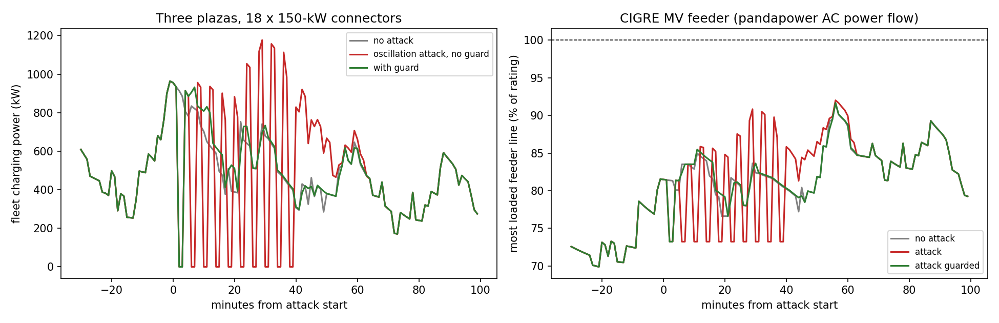

# EV fast-charging surge guard results

3 plazas, 18 connectors; guard fitted on 21 benign days. Thresholds: ramp 495 kW/min per plaza, 7 simultaneous limit jumps, forecast residual 422 kW.

## False alarms over 7 benign test days

| Detector | Alarms |
|---|---|
| ramp | 0 |
| forecast | 0 |
| telemetry | 0 |
| reconciliation | 0 |
| grid mitigations triggered | 0 |

## Attack days (evening peak)

| Attack | Start (cars plugged in) | Detected by | Time to detect (min) | Peak fleet kW: none / attack / guarded | Largest 1-min swing kW: none / attack / guarded | Worst line loading %: none / attack / guarded | Min voltage pu |
|---|---|---|---|---|---|---|---|
| sync_ramp | 19:24 (8/18) | none | - | 855 / 855 / 855 | 280 / 280 / 280 | 92 / 92 / 92 | 0.935 / 0.935 / 0.935 |
| oscillation | 17:08 (8/18) | ramp | 4 | 964 / 1177 / 964 | 368 / 1177 / 934 | 92 / 92 / 92 | 0.935 / 0.935 / 0.935 |
| soc_spoof | 18:49 (9/18) | telemetry | 3 | 938 / 938 / 938 | 296 / 296 / 296 | 96 / 96 / 96 | 0.931 / 0.931 / 0.931 |
| meter_tamper | 17:59 (8/18) | reconciliation | 2 | 862 / 862 / 862 | 274 / 274 / 274 | 95 / 95 / 95 | 0.932 / 0.932 / 0.932 |
| sync_ramp | 18:49 (12/18) | none | - | 1340 / 1340 / 1340 | 304 / 304 / 304 | 96 / 96 / 96 | 0.931 / 0.931 / 0.931 |
| oscillation | 17:34 (11/18) | ramp | 4 | 1176 / 1176 / 1176 | 275 / 883 / 883 | 96 / 98 / 96 | 0.932 / 0.930 / 0.932 |
| soc_spoof | 16:54 (10/18) | telemetry | 0 | 1208 / 1208 / 1208 | 381 / 381 / 381 | 94 / 94 / 94 | 0.933 / 0.933 / 0.933 |
| meter_tamper | 17:49 (11/18) | reconciliation | 2 | 1101 / 1101 / 1101 | 382 / 382 / 382 | 93 / 93 / 93 | 0.933 / 0.933 / 0.933 |

